# Atlas vivo de El Linde del Velo

Estado: prototipo probado con el motor real en un servidor aislado y en OBS sin emitir, 11 de octubre de 2026. Falta probarlo con el chat de Twitch. Encargo: [ENCARGO-CLAUDE-ATLAS-VELO.md](ENCARGO-CLAUDE-ATLAS-VELO.md). Archivo: [mmo-atlas.html](../biblioteca/overlays/mmo-atlas.html). Prueba: [scripts/prueba-atlas.mjs](../scripts/prueba-atlas.mjs). No toca el motor ni el panel, y no está en ningún commit.

El atlas es una segunda vista del mundo, de 1920 × 1080, pensada para emisiones largas sin webcam. Enseña la Última Lumbre y las tres tierras tras el Velo como un mapa: dónde está la compañía, qué tierras están cartografiadas, el objetivo de la salida y lo que tiene que escribir el chat. Solo lee `GET /api/mmo/estado` cada 3 s. No escribe nada ni manda mensajes al chat.

## Cómo probarlo

| Uso | Enlace u orden |
| --- | --- |
| Con el bot encendido | `http://localhost:7070/biblioteca/overlays/mmo-atlas.html` |
| Demo con botones | `…/mmo-atlas.html?demo=1` (también funciona abriendo el archivo directamente) |
| Demo de un estado concreto, sin botones | `…/mmo-atlas.html?demo=1&captura=1&escena=victoria&region=marisma` |
| Prueba con el motor real | `node --import tsx scripts/prueba-atlas.mjs vivo` |
| Prueba de la demo y casos límite | `node --import tsx scripts/prueba-atlas.mjs demo` |

Escenas de la demo: `calma`, `expedicion` (una persona), `grupo` (seis), `aporte`, `encrucijada`, `voto1`, `voto2`, `decidir`, `victoria`, `cierre`, `pausa`, `sin-directo`, `sin-chat`, `desconexion`, `cerrado` y `region` (pasa a la región siguiente). Regiones: `bosque`, `cantera`, `marisma`. La demo construye objetos con la misma forma que `EstadoPublico` y usa misiones reales de `contenido.ts`.

`scripts/prueba-atlas.mjs` usa SQLite en memoria y abre el servidor del panel en un puerto efímero. Hace pasar el motor real por todos sus estados y comprueba con Edge sin interfaz lo que pinta el atlas. Bloquea cualquier petición fuera del servidor local. Streamer.bot, OBS y la IA de pago están sustituidos por funciones que fallan.

Capturas de la demo (Canteras del Eco):

| Calma | Expedición | Grupo | Encrucijada |
| --- | --- | --- | --- |
| 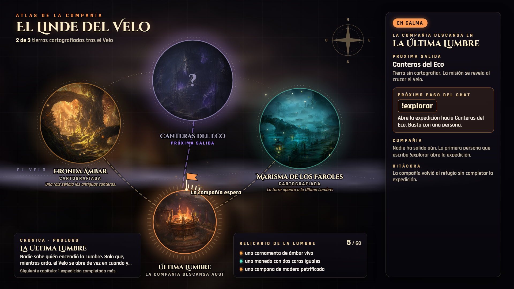 | 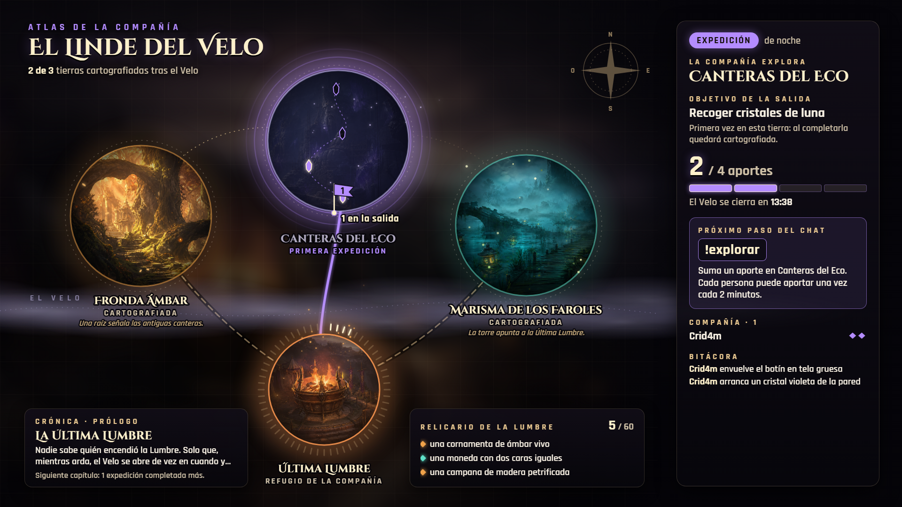 | 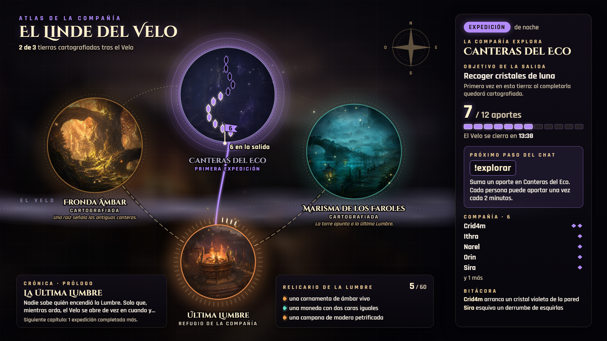 | 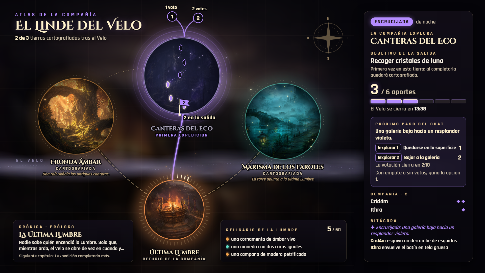 |
| **Victoria** | **Cierre sin completar** | **Pausa** | **Desconexión** |
| 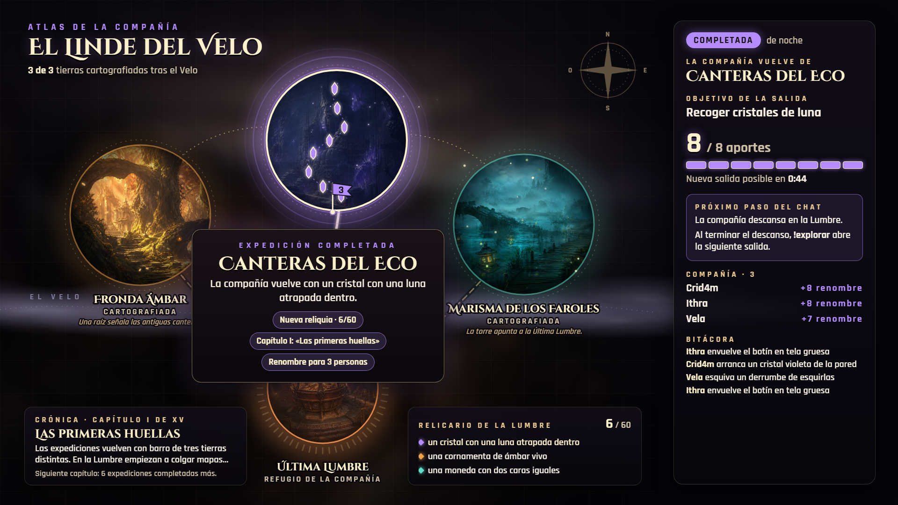 | 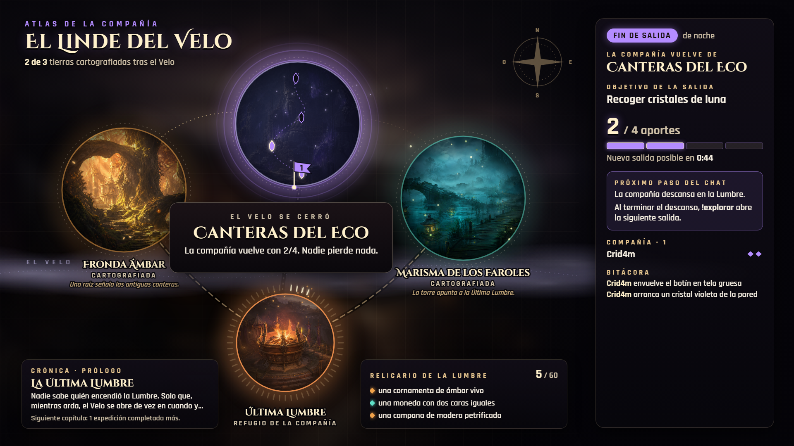 | 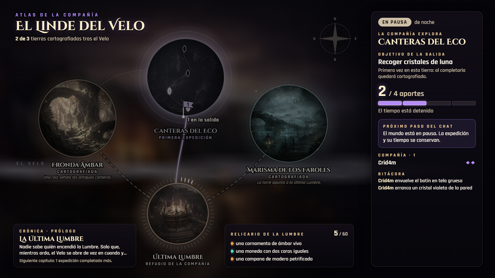 | 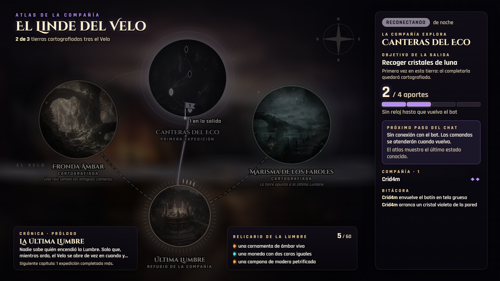 |

Capturas con el motor real, leyendo `/api/mmo/estado` (base vacía; la primera salida es a la Fronda):

| Bot sin responder | Calma, nadie ha jugado | Expedición (2 personas) |
| --- | --- | --- |
| 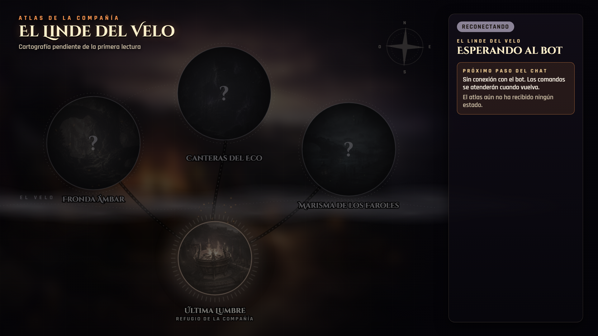 | 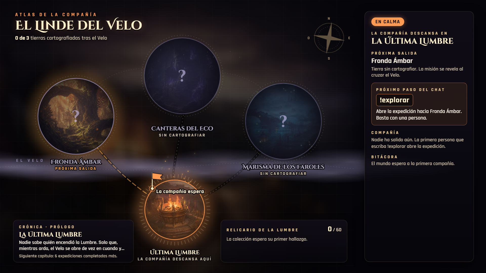 | 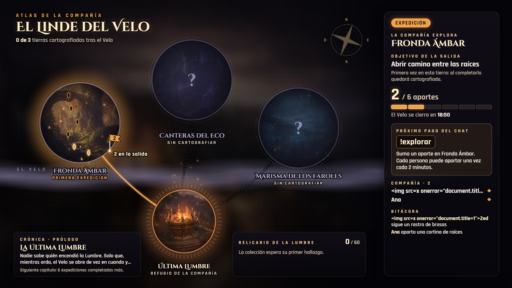 |
| **Encrucijada con un voto** | **Victoria por el camino arriesgado** | **Desconexión a mitad de salida** |
| 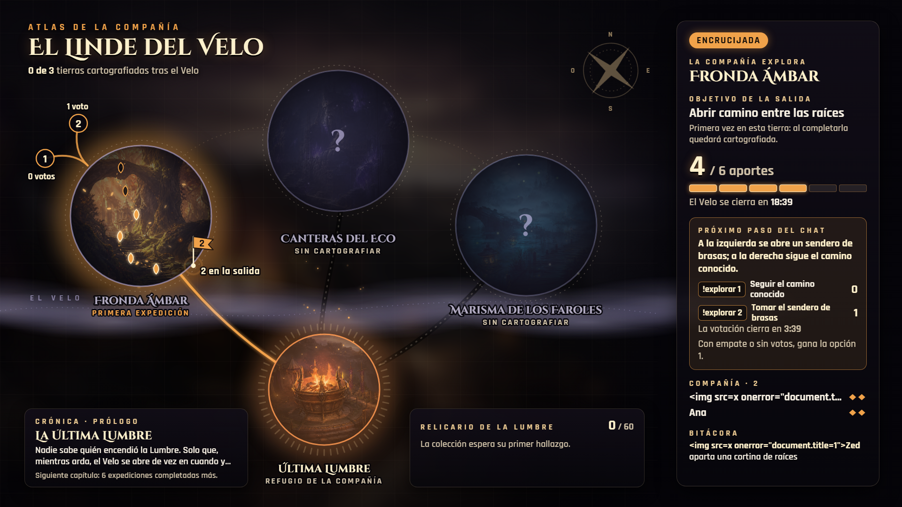 | 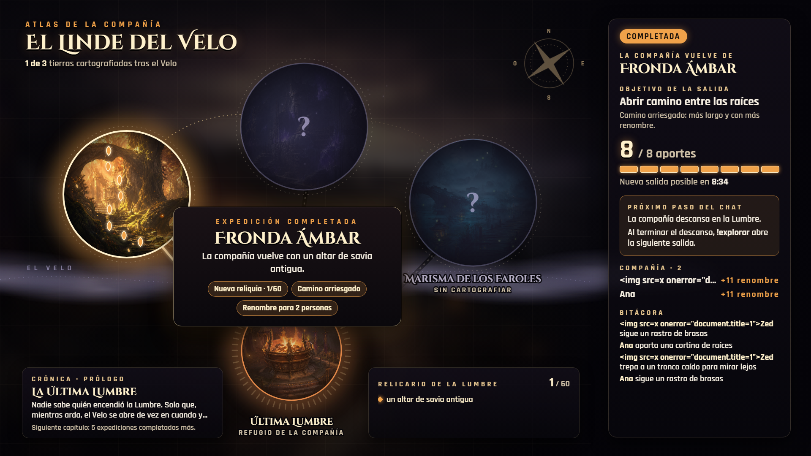 | 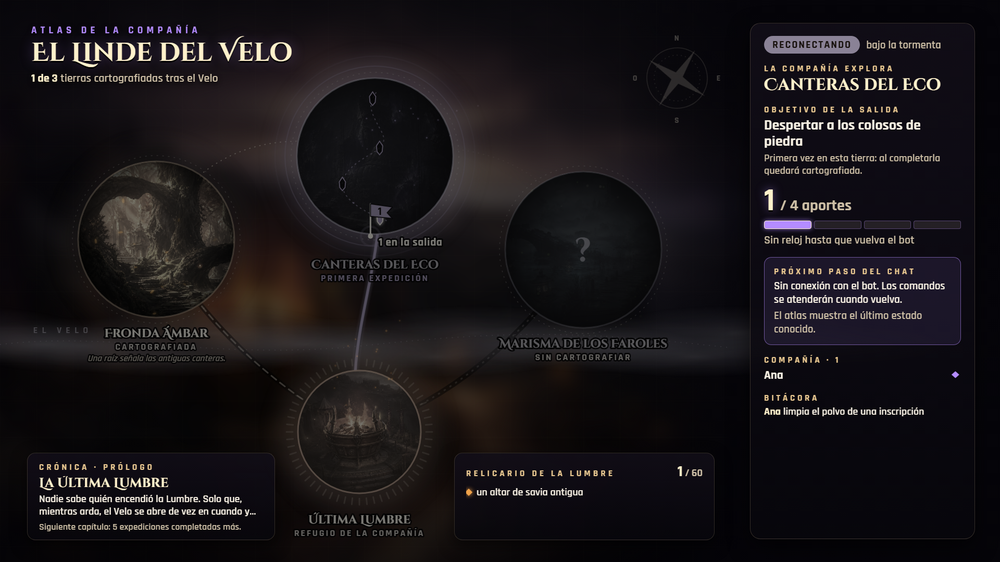 |

En las capturas reales, uno de los participantes se llama `Zed` a propósito: sale como texto, recortado, y no se ejecuta.

## Integración con el overlay principal

`mmo.html` sigue siendo la escena del juego. El atlas no la sustituye: lee el mismo estado y no se coordina con ella, así que las dos pueden estar abiertas a la vez sin conflicto.

Propuesta, de menos a más trabajo:

1. **Segunda fuente en la escena del mundo.** Añadir `ESC Atlas del Velo` (navegador, 1920 × 1080, la URL de arriba) a `✦ El Linde del Velo`, oculta por defecto. Crid4m decide cuándo la enseña. No hace falta cambiar código. Lo haría «Crear escena en OBS» del panel o Crid4m a mano, nunca el atlas.
2. **Alternancia en calma.** Que `mmo.html` muestre el atlas tras unos minutos de calma sin actividad y vuelva a su vista al empezar una expedición. Se puede hacer con un `<iframe>` del atlas dentro de `mmo.html` o con una acción de Streamer.bot que alterne la visibilidad de las dos fuentes. Es trabajo de Codex, porque toca `mmo.html`.
3. **Fusión.** Llevar el mapa SVG a `mmo.html` como vista de calma. Solo merece la pena si la prueba con gente confirma que el atlas se entiende mejor.

El atlas usa la ruta relativa `/api/mmo/estado`, así que debe servirse desde el panel (puerto 7070), no como archivo local. Abierto como archivo y sin `?demo=1`, se queda en «Esperando al bot». El atlas no trae audio. La música sigue en el sistema de Música.

## Datos del contrato que usa

Todos los campos vienen de `EstadoPublico` (`version: 1`) en `src/interactions/mmo/index.ts`, más `chatConectado`, que añade `src/panel/server.ts`. Si la respuesta no trae `version 1`, `region`, `objetivo` y `participantes`, se descarta y se mantiene lo último que se pintó.

| Campo | Dónde se ve |
| --- | --- |
| `modo`, `fase`, `detenido`, `chatConectado` | Etiqueta de estado, filtro del mapa (pausa y cerrado apagan el color) y texto del «Próximo paso del chat». `chatConectado: false` cuenta como tiempo detenido, igual que `detenido: 'sin-chat'`. |
| `region.id/nombre/objetivo` | Medallón activo, ruta encendida, estandarte y lateral. En calma, `region` es la **próxima** salida (el motor la calcula como `expedicion_id % 3`) y se marca como «Próxima salida». |
| `objetivo.actual/meta` | Contador, barra y **rastro**: un glifo por aporte de la meta dentro del medallón (brote, cristal o farol), encendido solo con aportes reales. La meta del motor va de 4 a 14 (12 con cinco o más personas, +2 por el camino arriesgado). El rastro admite hasta 16. |
| `hasta` | Cuenta atrás del Velo o del descanso. Si es `null`, el reloj se muestra parado y nunca inventa un plazo. |
| `participantes` | Lista de la compañía y número del estandarte. Enseña hasta cinco nombres; si una encrucijada larga ocupa el lateral, menos, y el resto pasa a «y N más». Los nombres entran con `textContent` y se recortan con puntos suspensivos. |
| `acciones` | Bitácora: hasta cuatro, y solo las que caben enteras; si no cabe ninguna, el bloque se oculta. `suceso: true` va en cursiva y sin nombre. |
| `encrucijada` | Dos ramas que salen del medallón con los votos reales, la pregunta, `!explorar 1` / `!explorar 2` y el reloj de votación. Tras decidir, la rama elegida brilla y la otra se apaga. |
| `resultado` | Cartel de final: hallazgo, nueva reliquia, capítulo, camino arriesgado y renombre por persona. Solo estalla cuando el final es nuevo: al recargar la página durante el descanso, el cartel aparece sin animación. |
| `clima` | Velo de color sobre el medallón activo (amanecer, ocaso, noche, niebla, tormenta). |
| `reliquias.halladas/total` | Anillo de 60 marcas alrededor de la Lumbre. Las nuevas destellan una vez. |
| `memoria.regiones` | Tierra cartografiada o velada (con «?»), ruta y pista conocidas, partículas de la región. |
| `memoria.piezas` | Relicario de la Lumbre (las tres últimas, con el color de su región). |
| `cronica` | Tarjeta de crónica y cuántas expediciones completadas faltan para el siguiente capítulo. Con `siguienteEn: null` pone «La crónica está completa». |
| `ultimoSuceso` | Bitácora en calma, cuando no hay acciones. |

**Lo que el atlas añade sin datos del motor:** posición de las tierras en el mapa, rutas, nombres de las pistas («Una raíz señala las antiguas canteras.») y el reparto de glifos. Son geografía fija del atlas, no estado del juego.

**Si el bot no contesta:**
- **Ya hubo alguna lectura.** El atlas conserva la última, pasa el mapa a gris, pone «Reconectando» y lo explica en el «Próximo paso del chat». Ese aviso antes era un cartel flotante sobre el mapa; se quitó porque tapaba las ramas de una encrucijada en las Canteras.
- **No ha llegado ninguna.** El atlas enseña solo el mapa y «Esperando al bot», sin próxima salida, compañía, cuentas ni relicario.

**Límite del contrato:** no hay identificador de expedición. Para saber si dos lecturas son la misma salida, el atlas compara región y fase. Como las tierras se recorren en ciclo, dos salidas seguidas nunca comparten región. Solo fallaría si el atlas estuviera desconectado justo tres expediciones completas, y entonces solo se perdería una animación. Con `expedicion_id` en el contrato se resolvería del todo.

## Datos reales y efectos ambientales

Separación estricta: **nada del ambiente se parece a progreso**.

| Real (cambia solo si cambia el estado) | Ambiente (se mueve siempre, no significa nada) |
| --- | --- |
| Medallón activo, ruta encendida y estandarte | Bandas de niebla del Velo que derivan despacio |
| Glifos del rastro y barra de aportes | Brasas sobre la Lumbre, hojas en la Fronda, polvo en las Canteras, luciérnagas en la Marisma |
| Ramas y votos de la encrucijada | Ondas de eco alrededor de las Canteras |
| Tierras cartografiadas o veladas, pistas y rutas conocidas | Pulso del brasero de la Lumbre |
| Anillo de reliquias y relicario | Giro de la rosa de los vientos (4 min por vuelta) |
| Crónica, bitácora, compañía, relojes | Relámpago ocasional si el clima real es tormenta |

Las partículas usan una semilla fija: siempre dibujan lo mismo y no dan a entender que alguien juega. Las tierras sin cartografiar reducen su ambiente al 22 %. En pausa, cierre o desconexión el ambiente baja al 25 %. Con `prefers-reduced-motion`, desaparece.

Con nadie jugando, el atlas enseña la Lumbre, la próxima salida y la invitación a escribir `!explorar`. Con una persona, el estandarte pone «1 en la salida» y la meta mínima del motor (4) se llena con ella sola.

## Comprobaciones hechas

### Probado mirando capturas (Edge sin interfaz, 1920 × 1080)

- **Demo:** los ocho estados de la tabla y la encrucijada con el panel de botones visible.
- **Otras regiones:** victoria y encrucijada en la Fronda y en la Marisma.
- **Lateral lleno:** la encrucijada real más larga de `contenido.ts` (83 caracteres) con siete personas de nombre largo.
- **Motor real:** bot sin responder, cerrado, calma vacía, expedición, encrucijada, victoria, calma con memoria, pausa, desconexión y cierre sin completar.

Fallos vistos y corregidos:

| Fallo | Corrección |
| --- | --- |
| El rótulo del estandarte pisaba el nombre de las Canteras. | Sus rótulos bajan 28 px. |
| El cartel de final rozaba el nombre de la Marisma y dejaba ver el rótulo de la región por debajo. | Se movió, su fondo ahora es opaco y oculta esos rótulos mientras está visible. |
| Un nombre largo en la Compañía sacaba del panel los ◆ y el «+N renombre» de todas las filas. | La lista se recorta con puntos suspensivos y respeta el ancho del panel. |
| Con una encrucijada larga, la bitácora quedaba cortada a media línea en el borde. | Solo quedan las entradas que caben enteras. |
| El botón de la demo tapaba el recuento de votos de las Canteras. | Ahora está junto a la rosa de los vientos. |
| El aviso de desconexión flotaba sobre la misma zona que las ramas. | Se quitó; el aviso va en el lateral. |
| Sin ninguna respuesta del bot, el atlas se inventaba «Próxima salida: Fronda Ámbar», «0 de 3», «0/60» y «La compañía descansa aquí». | Ahora solo enseña el mapa y «Esperando al bot». |

### Comprobado por la prueba automática

`scripts/prueba-atlas.mjs`: 19 comprobaciones con el motor real y 10 con la demo, todas superadas, sin errores de JavaScript en la página. La demo comprueba también que `prefers-reduced-motion` detiene las animaciones de resultado, las transiciones y las partículas.

- **Motor real:**
  - Arranque sin bot y primera lectura sin recargar.
  - Expedición con una persona y luego con dos: la meta pasa de 4 a 6 y hay 4 → 6 glifos.
  - Nombre con HTML: no se ejecuta y no sale del panel.
  - Encrucijada: el voto real aparece en las ramas, y el camino arriesgado sube la meta de 6 a 8.
  - Victoria: cartel, renombre, 1 de 3 tierras, 1/60 reliquias y una sola culminación.
  - Calma con memoria, sin repetir el cartel.
  - Pausa, sin directo, sin chat, desconexión y reconexión.
  - Cierre sin completar: sin destello de victoria y sin cartografiar la tierra.
  - Apagado.
  - El atlas hizo 25 lecturas de `GET /api/mmo/estado` y ninguna otra petición a `/api`.
- **Demo:**
  - 23 pulsaciones de botones, cada una con el estado esperado, y ninguna petición a `/api`.
  - Crónica completa («Capítulo XV de XV»).
  - Región desconocida: el lateral la nombra y el mapa no la sitúa.
  - Lateral lleno con dos y con siete personas sin que nada salga del panel.
  - El botón de la demo no se cruza con ramas, votos ni rótulos.

### Comprobado solo leyendo el código

- El atlas no hace `POST`; los textos del estado entran con `textContent` o `createTextNode`, nunca como HTML.
- Con las fuentes ya cargadas, el atlas repinta el mismo estado para medir bien la bitácora, sin repetir animaciones.
- Reglas del motor que el atlas repite en sus textos: empate o sin votos → opción 1; 45 s entre aportes de la misma persona; el camino arriesgado añade 2 a la meta.
- El estado `bot-apagado` (interruptor del bot) tiene texto propio, pero no lo ha recorrido ninguna prueba.
- Las animaciones de entrada, del cartel y de la culminación no se han visto en movimiento: Edge sin interfaz no avanza su reloj, así que la prueba las termina antes de capturar y cuenta cuántas se disparan.

### Prueba local en OBS (11 de octubre de 2026)

- OBS 32.2.2 estaba abierto en `✦ El Linde del Velo`, sin emisión ni grabación. El servidor del bot respondía en `127.0.0.1:7070`.
- Se añadió `ESC Atlas del Velo` como fuente de navegador de 1920 × 1080 a 30 fps, con la URL real del atlas. Quedó oculta por defecto. La fuente principal `ESC Linde del Velo` siguió activa.
- Se mostró temporalmente la fuente y se capturó la escena completa. El atlas leyó el estado real: mundo activo, fase de calma, próxima salida a Canteras del Eco y tiempo detenido por falta de directo. [Captura de OBS](previews/mmo/obs-atlas-real.png).
- En la misma fuente se probaron temporalmente las URL de demo de [expedición](previews/mmo/obs-atlas-expedicion.png), [encrucijada](previews/mmo/obs-atlas-encrucijada.png) y [victoria](previews/mmo/obs-atlas-victoria.png). Se revisaron el encuadre y los textos a 1920 × 1080.
- Con la fuente visible se compararon dos capturas separadas por cinco segundos: cambió el 1,15 % de los puntos muestreados, principalmente niebla, partículas, brasas y rosa de los vientos. OBS indicaba 60 fps y 0,37 ms de renderizado medio en ese momento; esas cifras son de OBS completo, no una medición aislada del atlas. Las animaciones de entrada y culminación siguen pendientes de observarse en movimiento.
- Al acabar se restauró la URL real y la fuente quedó oculta. No se inició emisión, grabación ni se enviaron comandos al chat.

### Sin probar

- En OBS durante un directo, con el chat de Twitch real y durante horas.
- El tiempo real de 20 min de expedición: la prueba adelanta el reloj del motor. Por eso, en las capturas reales, el descanso marca minutos de más.

## Ampliaciones propuestas para 8–12 horas

Hoy una sesión larga repite el mismo ciclo: tres tierras, una meta de 4 a 14 aportes y un final. El chat necesita objetivos que duren horas y que se vean en el mapa. Las tres propuestas usan `!explorar`, sin comandos nuevos, y ninguna avanza con el tiempo.

### 1. Cartografía de lugares (prioridad alta, poco motor)

- **Entrada:** cualquier expedición completada.
- **Acción del chat:** la de siempre, `!explorar` hasta completar.
- **Persistencia:** ya existe. `mmo_expediciones` guarda `mision_id` y `mmo_resultados` guarda `completada`. Basta con añadir al contrato `memoria.lugares: Array<{ region, mision, nombre }>` con las misiones completadas al menos una vez.
- **Resultado visible:** cada tierra tiene 10 misiones, así que el atlas dibuja 10 lugares alrededor de su medallón, que se encienden para siempre al completarlos («Lago de hojas», «Galería violeta»…). Una tierra con todos sus lugares se marca como **explorada del todo**. Son 30 lugares en total, que dan para varias sesiones largas, y el chat ve qué falta.

### 2. Racha de la compañía (prioridad media)

- **Entrada:** expediciones completadas seguidas, sin un cierre fallido entre ellas.
- **Acción del chat:** completar salidas seguidas. Si el Velo se cierra, la racha vuelve a 0. Nadie pierde renombre.
- **Persistencia:** columna `racha` en `mmo_world`. Sube al completar y vuelve a 0 al fallar. Se guarda al reiniciar el bot y no corre sin directo, porque el tiempo ya se congela.
- **Resultado visible:** las rutas recorridas en la racha quedan encendidas en el mapa. Con racha 3, la siguiente salida promete una reliquia de una misión que aún no se ha completado, si queda alguna. Contrato: `racha: number`.

### 3. Corazón de la tierra (prioridad media, más motor)

- **Entrada:** una tierra con al menos 5 de sus 10 lugares cartografiados (depende de la propuesta 1).
- **Acción del chat:** la siguiente salida a esa tierra es su «Corazón»: meta doble y una encrucijada segura en lugar del 40 % habitual. La meta se ajusta a quienes participen, como hoy, para que una persona sola pueda terminarla.
- **Persistencia:** tabla `mmo_hitos (region_id, tipo, expedicion_id, at_ms)`. El Corazón solo se gana una vez por tierra.
- **Resultado visible:** un faro permanente en el medallón, la niebla del Velo se aparta de esa ruta y la crónica añade un capítulo propio. Contrato: `memoria.hitos: string[]`. Con las tres tierras ganadas, el Velo entero retrocede: es el final de temporada natural.

Mejora pequeña sin tocar el motor: el contrato ya envía seis piezas en `memoria.piezas` y el atlas solo enseña tres. Podría ir pasando por las seis cada medio minuto. Son datos reales en otro orden, no actividad inventada.

## Para integrar (Codex)

- **Contrato:** el atlas no necesita cambios en el motor. Si se añade `expedicion_id` a `EstadoPublico`, el atlas puede usarlo en lugar de comparar región y fase (`mismaSalidaQue` y `claveResultado`).
- **`chatConectado`:** `server.ts` lo añade y el motor ya da `detenido: 'sin-chat'` con la misma información. El atlas acepta cualquiera de los dos; si se quita uno, no se rompe.
- **OBS:** `ESC Atlas del Velo` ya existe en `✦ El Linde del Velo` y está oculta por defecto. Si se quiere que «Crear escena en OBS» la cree automáticamente en instalaciones nuevas, habrá que añadirla a esa función.
- **Pruebas:** `scripts/prueba-atlas.mjs` es independiente de `scripts/pruebas-visuales.mjs`. Se puede dejar así o pasar a un caso `atlas` de ese script.
- **Cuarta región:** necesitaría posición, ruta, recorte de imagen y glifo en `REGIONES` del atlas. Hasta entonces, el lateral la nombra pero el mapa no la sitúa.
